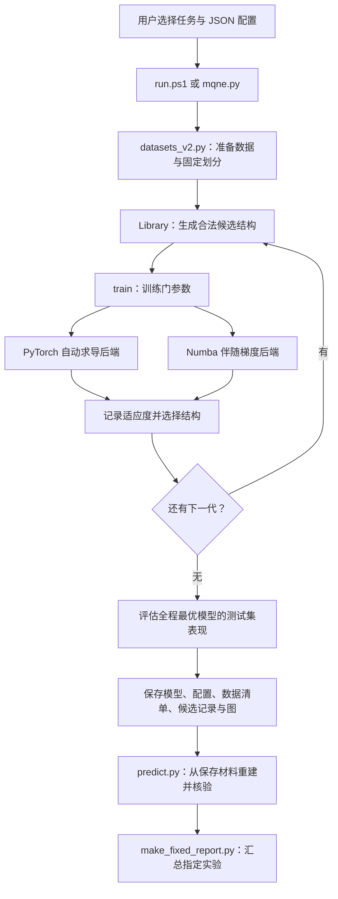

# MQNE 项目：代码架构与关键功能实现

适用目录：`D:\课程\博二上\量子人工智能\Project\MQNE_DLD21PRA`  
文档日期：2026-10-17。本文依据主目录当前代码编写；`archive/` 中的历史代码不属于本文描述的运行版本。

本项目用 Python 在经典计算机上模拟量子线路，尝试复现 Lu、Shen、Deng 的 *Markovian Quantum Neuroevolution for Machine Learning*，Physical Review Applied 16, 044039 (2021)。它同时优化“线路长什么样”和“门的角度是多少”。当前实现采用精确状态向量模拟，不需要连接真实量子计算机。

阅读顺序：先看第 1—3 节了解整体流程，再按需要查看数据、门库、训练和恢复部分。运行命令与结果文件的解读见 [使用与结果解读](使用与结果解读.md)；实验结论见 [修复与复现报告](../REPRODUCTION_FIXED_20261013.md)。

## 1. 先理解程序在做什么

可以把一条量子线路理解为一串带可调角度的计算操作。MQNE 的搜索包含两层：

1. **结构搜索**：从合法门块库中抽取线路；训练后留下表现好的结构，下一代在它后面继续添加门块。
2. **参数训练**：对每一条候选线路，用 Adam 调整门的旋转角，使它尽可能正确地区分两类样本。

“Markovian”体现在生成下一个门块时，合法后继由上一个门块决定。它并不表示下一代的选择只依赖最后一个门块：结构的优劣仍取决于整条线路训练后的表现。

需要区分三个对象：

| 对象 | 在代码中是什么 | 例子 |
|---|---|---|
| 门块 | `Block`，一组互不占用同一量子位的门 | 某些量子位上的 R，以及相邻位之间的 CRx |
| 线路结构 | `path`，门块在库中的编号序列 | 首块固定为所有量子位上的 R，后续按合法关系抽样 |
| 训练参数 | `Circuit.theta`，一维角度数组 | 每个 R 占 3 个参数，每个 CRx 占 1 个参数 |

本实现中，下一代继承父代的**结构前缀**，随后为整条候选线路重新初始化并训练参数。它没有继承父代已经训练好的角度，也没有进行参数热启动。

## 2. 整体架构与数据流



`run_reference.py` 是另一条入口：它直接指定线路结构，再复用同样的数据准备和参数训练流程。因此“固定结构对照实验”和“MQNE 自动搜索”可以共享实现，但两者的实验含义不同。

### 文件职责

| 文件 | 负责什么 | 主要阅读入口 |
|---|---|---|
| [mqne.py](../mqne.py) | 门块、门库、PyTorch 线路模拟、训练分发、结构搜索及保存 | `Block`、`Library`、`Circuit`、`train()`、`run()` |
| [datasets_v2.py](../datasets_v2.py) | 三类数据、固定划分、缓存校验、位顺序和按清单恢复 | `dataset_v2()`、`fixed_partitions()`、`download_mnist()` |
| [native_backend.py](../native_backend.py) | CPU 上的 Numba 状态模拟、伴随梯度和 Adam 更新 | `operations()`、`forward()`、`loss_gradient()`、`adam_epoch()` |
| [run_reference.py](../run_reference.py) | 论文 Fig. S11、brickwork 和历史 SPT 结构对照 | `paper_s11()`、`brickwork()`、`main()` |
| [predict.py](../predict.py) | 重建保存的线路和数据，复算并核对指标，导出预测 | `main()`、`verify_metrics()` |
| [verify_finished.py](../verify_finished.py) | 检查完整实验的候选预算、结构、资源计数，并逐项恢复 | `main()` |
| [verify_corruption.py](../verify_corruption.py) | 故意破坏记录，验证普通及优化模式都会拒绝不一致结果 | `main()` |
| [audit.py](../audit.py) | 门库规模、后继关系规模及论文编号兼容性核验 | `main()` |
| [make_fixed_report.py](../make_fixed_report.py) | 从指定的已完成实验生成报告、线路图和汇总图 | `EXPECTED`、`main()` |
| [summarize.py](../summarize.py) | 报告生成程序的兼容入口 | 调用 `make_fixed_report.main()` |
| [run.ps1](../run.ps1) | PowerShell 运行入口，选择配置和生成新结果目录名 | `Task`、`Scale`、`Device` 参数 |
| [test_mqne.py](../test_mqne.py)、[test_fixes.py](../test_fixes.py) | 数学实现、数据协议和后端一致性测试 | 各个 `test_*` 方法 |

源码之间的核心调用方向是：`mqne.run()` → `dataset()` / `Library.sample()` / `train()`；`train()` 再根据配置进入 PyTorch 或 Numba 后端。数据模块通过参数接收归一化函数和哈密顿量构建函数，避免在模块顶层反向导入主程序。

### 目录职责

| 目录 | 内容与使用方式 |
|---|---|
| `configs/` | 当前完整规模配置，以及三个用于试运行的 pilot 配置 |
| `data/` | MNIST 原始缓存、SPT 状态缓存和 `partitions_v2/` 母划分；恢复历史结果需要的旧 SPT 缓存也保留在这里 |
| `results/` | 当前完整实验，每个运行一个独立子目录；已有结果应保留，新实验另建目录 |
| `references/` | 对照实验所需的结构来源等材料 |
| `figures/`、`logs/` | 汇总图和已有运行日志；直接运行 Python 不会自动将终端输出保存到 `logs/` |
| `fix_evidence_20261013/` | 已有恢复核验、回归核验及代码/交付哈希等证据 |
| `archive/` | 已被替代的代码、早期结果、中止运行、旧配置与历史报告 |
| `docs/` | 当前用户文档 |

## 3. 一次完整搜索如何执行

`mqne.run(config, root, output, circuit_file=None)` 按以下顺序工作：

1. 检查后端、设备及关键整数配置，创建一个必须尚不存在的输出目录，保存实际配置。
2. 设置随机种子和线程数，准备训练、验证、测试数据，将具体索引及数据指纹写入 `data_manifest.json`。
3. 创建对应量子位数的门库。第一代独立抽取 `population` 条线路，每条长度为 `initial_length`。
4. 对每条线路从头训练参数，记录适应度、训练历史、资源计数、耗时和更新次数。
5. 若本候选优于此前所有候选，立即更新 `best_circuit.json` 与 `best_parameters.pt`；每个候选完成后更新 `candidates.json`。
6. 下一代只从上一代的候选中选择适应度最高的 `survivors` 个父结构。每个父结构产生 `population` 条子线路，每条追加 `extension_length` 个门块。
7. 达到代数上限或代末满足适应度阈值后，选用**搜索全程**的最优模型评估测试集，并保存 `summary.json` 和曲线。

“下一代的父结构”和“最后交付的最优模型”使用不同范围：前者来自上一代，后者来自所有已经训练的候选。最优线路因此可能来自较早的一代。

若没有提前停止，一次搜索训练的候选数为：

```text
候选总数 = population × [1 + (generations − 1) × survivors]
第 g 代线路块数 = initial_length + (g − 1) × extension_length
```

当前完整配置是 10 个初代候选、1 个父结构、6 代，因此训练 60 条候选。这里 `population` 表示**每个父结构产生的候选数**；将 `survivors` 改为 2 时，后续每代会训练 20 条，不能仍按每代 10 条估算预算。

搜索中可能重复抽到相同结构，代码没有进行结构去重。适应度相等时，更新最优模型的严格大于判断会保留先出现的最优记录。

## 4. 数据如何变成线路输入

### 4.1 振幅编码与输出辅助位

Cancer 的 30 维特征补零到 64 维，表示 6 个输入量子位；MNIST 和 SPT 的 256 维向量表示 8 个输入量子位。每个输入向量经过 L2 归一化，使振幅平方和为 1；零向量会报错。

线路另外添加一个初态为 `|0>` 的输出辅助位，因此实际模拟的是 7 或 9 个量子位。内部第 0 号量子位是最高有效位，最后一个量子位是最低有效位。添加辅助位后，输入振幅依次位于状态数组的偶数下标，奇数下标初始为零。

线路输出 `p_class1` 是辅助位处于 `|1>` 的概率，即最终状态数组奇数下标的振幅模平方之和。分类阈值为 0.5：概率大于等于 0.5 判为类别 1。

| 任务 | 类别 0 | 类别 1 |
|---|---|---|
| Cancer | 良性 | 恶性 |
| MNIST | 数字 1 | 数字 9 |
| SPT | `lambda <= 1` | `lambda > 1` |

### 4.2 三类任务的处理

**Cancer**：读取 scikit-learn 随包提供的乳腺癌数据，固定母池容量为训练 400、验证 169。`feature_transform` 可以选择 `raw`、`standard` 或 `minmax`。后两种变换的统计量只由本次训练子集计算，并保存到清单；恢复时使用原统计量。此任务没有额外测试集，验证表现不能称为独立测试表现。

**MNIST**：下载官方训练集和测试集，只保留数字 1、9。图像用 Pillow 双线性缩小到 16×16，按行展平并归一化。训练、验证来自官方训练数据的固定母划分（2000/500）；额外测试来自官方测试数据，当前完整配置取 500 个分层抽样样本。

**SPT**：在 `[0, 2)` 中抽取 2500 个 `lambda`，构造周期边界的八自旋哈密顿量：

```text
H(lambda) = −Σ X[j−1] Z[j] X[j+1] + lambda × Σ Y[j] Y[j+1]
```

程序通过稀疏本征求解 `eigsh(..., which='SA')` 求基态。前 2000 个样本形成 1600/400 的训练和验证母池，后 500 个作为额外测试池。状态缓存保存基态、标签、lambda 和本征残差；加载时检查 lambda 一致、状态维度、有限值、归一化及残差。有限尺寸简并时的基态选取仍可能与原作者环境不同。

### 4.3 固定划分怎样避免跨运行混用样本

`seed` 主要影响结构抽样和参数训练；`split_seed` 单独决定数据母划分。`fixed_partitions()` 将母池索引持久化到 `data/partitions_v2/`，后续运行检查标签指纹、划分种子和池容量后再复用。

小规模运行取各自母池的前缀，而不是重新把所有样本混在一起切分。例如 pilot 的训练样本永远来自训练母池，不会因为扩大样本数或更换搜索种子而跑进完整实验的验证母池。这保证训练/验证角色稳定；小前缀本身不保证与完整母池具有完全相同的类别比例。

`data_manifest.json` 记录实际索引、数据来源指纹、母划分指纹、预处理和位顺序。恢复时优先使用这些保存的信息，而不是根据当前配置重新抽样。文件哈希和数据指纹分别用于核对文件内容和数组内容，不应混为同一个概念。

### 4.4 MNIST 下载如何处理损坏和中断

`download_mnist()` 先检查缓存 SHA256，并解压校验 gzip 的 CRC、IDX 头、尺寸、样本数及标签范围。需要重新下载时，先写带唯一标识的 `.part` 临时文件；核验通过后用 `os.replace()` 原子替换目标文件。异常退出会清理当前下载临时文件。

首次成功下载后会建立本地 SHA256 清单；后续下载也必须符合已有清单。该清单是首次通过格式检查的本地基准，不是下载前已取得的第三方签名。

### 4.5 Yao 位顺序映射

`input_bit_order="msb"` 保持输入不变；`"yao_lsb"` 将振幅下标的二进制位反转。例如三位下标 `001` 映射为 `100`。这用于对齐 Yao 低编号量子位作为最低有效位的约定，线路内部的物理线序保持不变。

位顺序对齐不等于确定了原作者图像展平、缩放等全部预处理细节。恢复旧模型时，位顺序取自其保存的清单。

## 5. 合法门块库怎样生成

`Block` 保存两部分：`rotations` 表示哪些位使用 R，`pairs` 保存 CRx 的 `(控制位, 目标位)`。R 按时间顺序执行 `Rz(alpha)`、`Rx(beta)`、`Rz(gamma)`，三个参数；CRx 为受控 X 轴旋转，一个参数。

`Library.__init__()` 枚举相邻量子位之间的双向 CRx 组合，要求同一门块内各门不共用量子位，再为剩余位枚举“有 R / 无 R”。全恒等块被排除。7、9 个量子位分别得到 895、6687 个非空门块。

相邻块的规则由 `Library.allowed(a, b)` 表达：

- 新块中的 R 所在位必须被前一块的 CRx 占用，避免连续的单比特 R 可以直接合并。
- 新块不能重复前一块完全相同方向的 CRx。
- 新块中的每个 CRx 至少与前一块作用范围中的一个位相交。

实际抽样调用 `successors()`，用位掩码批量筛选并缓存合法后继。`allowed()` 则是较直观的逐块检查；测试会核对这两种判断方式。

首块固定为所有量子位上的 R。后续从当前门块的合法后继中均匀抽取。这表示每一步对合法后继均匀，并不意味着所有完整线路具有相同抽中概率。

代码中的门块编号有自己的枚举顺序，保存的 `path_1based` 是这个库的一基编号。论文的编号不能直接按本库解释；因此 `best_circuit.json` 同时保存明确的 `blocks` 门结构，恢复优先使用结构而不是猜测编号兼容性。

## 6. 两种后端如何完成同一项训练

### PyTorch：直接执行线路并自动求导

`Circuit` 将所有参数放在一个 `torch.nn.Parameter` 中。构造时预先计算每个门影响的状态下标；执行时只更新对应振幅对，不构造整条线路的巨大稠密矩阵。

模型使用 `float64` 参数和 `complex128` 状态。输出概率经裁剪后用于二元交叉熵损失，`loss.backward()` 计算梯度，`torch.optim.Adam` 更新参数。该后端也是保存模型恢复核验时使用的实现。

### Numba：融合 R，并从末态反向计算梯度

`operations()` 把线路结构转换为门类型、目标位掩码、控制位掩码、参数偏移四个数组。`forward()` 使用 Numba 编译的循环更新状态；一个 R 的三个旋转融合为一个 2×2 操作。

`loss_gradient()` 先计算末态及损失，再构造与输出概率有关的伴随向量。从最后一个门向前遍历时，用门的共轭转置重建前一状态，同时传播伴随向量并累加参数梯度。它不为每个参数单独完整运行两次线路，也不依赖有限差分来训练。

这种实现不保留所有门的完整中间状态；训练期间的主要状态数组随批量样本数和 `2^量子位数` 增长。它降低了自动求导图及中间状态保存的开销，但模拟成本仍随量子位数指数增长。

`adam_epoch()` 使用一阶、二阶动量、偏差修正及 `1e-8` epsilon。Numba 后端沿用 PyTorch 的参数初值和批次随机顺序，便于比较；训练结束后把参数写回 `Circuit`，继续使用统一的保存和评估接口。它只支持 CPU，首次编译会有额外开销。

两种后端在概率、梯度及短程 Adam 更新上的一致性由 `test_fixes.py` 检查；浮点运算路径不同，因此不承诺任意环境下每一位结果都完全一致。

### 训练长度与适应度

`training_unit="epoch"` 表示一轮遍历全部训练样本；`"step"` 表示每轮只随机选一个 batch。配置中的 `epochs` 因而在两种模式下代表不同工作量。

以当前完整配置为例，每个候选的 Adam 更新次数为：

| 任务 | epoch × 每轮 batch 数 | 每候选更新次数 |
|---|---|---|
| Cancer | `150 × ceil(400/20)` | 3000 |
| SPT | `150 × ceil(1600/20)` | 12000 |
| MNIST | `200 × ceil(2000/30)` | 13400 |

默认 `fitness="combined"` 按样本数加权：

```text
适应度 = (训练准确率 × 训练样本数 + 验证准确率 × 验证样本数)
         / (训练样本数 + 验证样本数)
```

它不是训练和验证准确率简单各占一半。设为 `validation` 时才仅按验证准确率选择。当前 `fitness_threshold=1.01` 高于准确率上限，用来禁用适应度提前停止。

## 7. 指定结构训练与模型恢复有什么区别

| 入口 | 结构来源 | 参数如何处理 | 用途 |
|---|---|---|---|
| `mqne.py` 默认运行 | 自动生成并逐代扩展 | 每条候选重新初始化 | 完整结构搜索 |
| `mqne.py --circuit ...` | 指定已保存的结构 | 重新初始化；只训练该结构一次 | 换预算等条件后的重训，不是继续上次优化 |
| `run_reference.py` | Fig. S11、brickwork10 或历史 SPT 结构 | 重新初始化 | 固定结构对照 |
| `predict.py` | 保存的明确门结构 | 直接加载保存的角度，不训练 | 恢复核验与导出逐样本预测 |

`--circuit` 会检查来源协议、任务、数据来源指纹、母划分、预处理、位顺序及部分跨角色样本交叉。缺少稳定来源记录的历史结构不能直接通过这条重训入口。

`run_reference.py` 的 `paper_s11()` 按补充材料逐门记录 MNIST 线路，并核对 15 块、28 个 R、22 个 CRx、106 个参数及合法后继。`brickwork10` 是项目构造的 10 层对照，不是作者原始代码。`legacy_spt_control` 只借用历史结构，检查新旧 lambda 不交叉，再在新固定数据上训练；不能视为一次新的结构搜索。

### 恢复核验的具体步骤

`predict.py` 读取 `config.json`、`best_circuit.json`、`summary.json`、`data_manifest.json`，用明确门结构重建 PyTorch 模型，载入角度并按保存索引恢复数据。随后分别复算训练、验证和可用测试集的损失、准确率。

`verify_metrics()` 显式检查有限值，并要求损失绝对差小于 `1e-8`、准确率绝对差小于 `1e-12`。失败时抛出 `ValueError`，因此在 `python -O` 关闭断言的情况下仍然有效。只有全部分区核验成功后，才写入预测 CSV 和 `restored_verification.json`；失败不会生成本次的新核验输出，但不会主动删除以前已经存在的文件。

这验证的是“保存的模型能否重现保存的指标”，不是“从随机初值再训练一次会不会得到同样的模型”。

## 8. 如何维护和扩展

| 想做的事 | 优先修改或阅读的位置 | 应同时确认的内容 |
|---|---|---|
| 改变训练预算、种子或编码 | 复制一份 `configs/*.json`，使用新输出目录 | 种子与划分种子分开；比较时更新次数一致 |
| 增加预处理 | `datasets_v2.dataset_v2()` | 仅用训练数据拟合统计量，记录到 manifest，恢复路径一致 |
| 增加数据任务 | 数据模块及各入口的任务/量子位映射 | 标签含义、母池容量、测试角色、参数维度及报告支持 |
| 改变门或连接关系 | `Block`、`Library`、`Circuit` 及 Numba 后端 | 两后端同时支持；参数顺序、合法后继和资源计数同步 |
| 添加新对照结构 | `run_reference.py` | 明确结构来源、合法性和与搜索结果的区别 |
| 把新实验加入汇总 | `make_fixed_report.py` 的 `EXPECTED` 及相关汇总逻辑 | 该脚本按当前 13 组实验编写，不会自动发现所有新目录 |

推荐在项目目录运行 `python -m unittest test_mqne test_fixes`，并按变更范围核验模型恢复。测试涵盖门幺正性、梯度、独立哈密顿量、门库与后继规则、固定划分、缓存处理、位顺序和后端一致性。

`verify_finished.py` 会扫描 `results/*/summary.json` 中的 `fixed_v2` 实验，检查候选预算等内容，再调用优化模式的 `predict.py`。它会重写恢复结果和部分证据文件，属于会产生输出的核验操作。

`audit.py` 会生成 `results/library_audit/`；这是门库分析目录，不是完整训练实验。它的已有历史输出位于归档目录，重新运行会创建新的分析输出。该脚本含有 `assert`，不要据此推断所有核验脚本在 `-O` 下都具有相同检查行为。

## 9. 阅读结果时必须保留的边界

验证集参与结构选择，不能当成完全未参与决策的盲测；多个编码、种子共用并已查看过的测试子集，也不能继续宣称是后续调参的全新盲测。

代码测试通过说明被覆盖的实现行为符合预期，模型恢复通过说明保存材料可以还原指标。它们都不自动等于论文全部结论已经复现。当前实验结论仍是部分复现；资源优势需要在相近精度和预算下比较。有关具体数值、未复现部分和原文未充分确定的实现细节，以 [修复与复现报告](../REPRODUCTION_FIXED_20261013.md) 为准。
